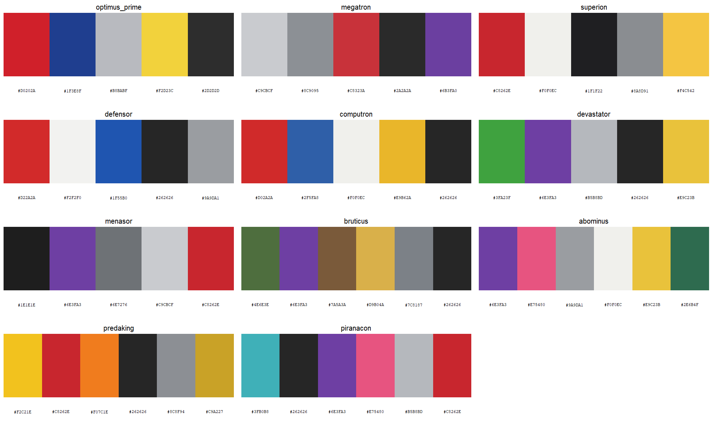
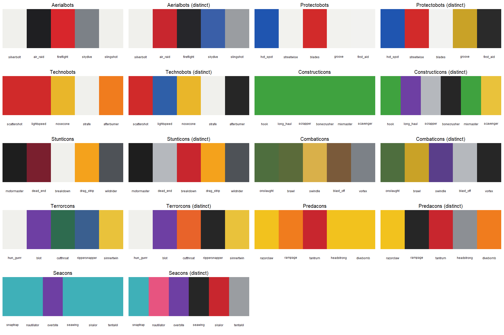
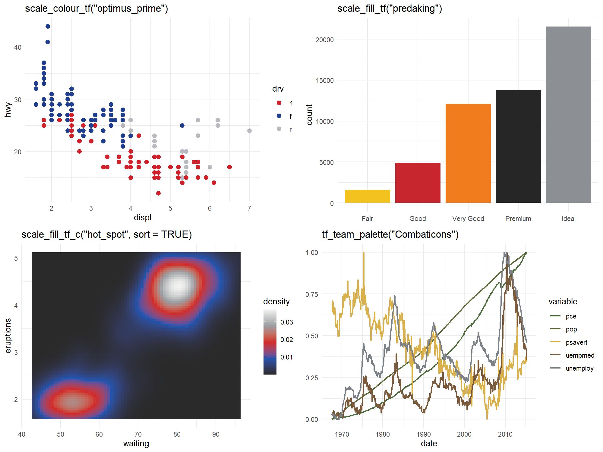
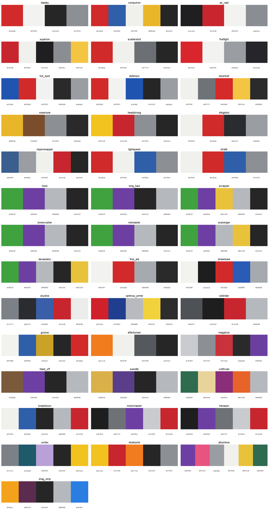

# transformeRs

<!-- badges: start -->
[](https://github.com/bmaitner/transformeRs/actions/workflows/R-CMD-check.yaml)
<!-- badges: end -->

Colour palettes for R and ggplot2 based on the original Generation 1
Transformers toys: Optimus Prime, Megatron, and every member and combined form
of the core combiner teams, from the Aerialbots and Superion to the Seacons
and Piranacon. It works the same way as packages like `wesanderson`: pick a
character by name, get a vector of hex colours, or drop a scale straight into
a ggplot. Because the combiner teams are sets of five or six figures, each
team also gives a ready-made categorical palette with one colour per member.

transformeRs is a fan project and is not affiliated with or endorsed by
Hasbro or Takara Tomy. Hex values are approximations of the toys' plastic,
chrome and paint colours; see "How the palettes were made" below.

## Browse online

Every palette, with its colours, toy photo and Transformers Wiki link, is
browsable and filterable at
<https://bmaitner.github.io/transformeRs/articles/browse.html>. Each card has
a **Suggest a change** link that opens a prefilled GitHub issue, and there is
a form to [request a character](https://github.com/bmaitner/transformeRs/issues/new?template=new-character.yml)
who is not covered yet. [`WISHLIST.md`](WISHLIST.md) lists what is queued.

## Installation

```r
# install.packages("pak")
pak::pak("bmaitner/transformeRs")
```

## Usage

```r
library(transformeRs)

# what is covered
tf_factions()
tf_teams()
table(tf_characters$team, tf_characters$faction)

# palette names, optionally for one faction, team or role
tf_palette_names()
tf_palette_names(team = "Constructicons")
tf_palette_names(role = "combined form")

# the colours of one character (prints the swatches and the hex codes)
tf_palette("optimus_prime")
#> Transformers palette 'optimus_prime' (5 colours)
#> Autobot: Optimus Prime
#> #D0202A #1F3E8F #B8BABF #F2D23C #2D2D2D

# first three colours, a 12-step gradient, or the same gradient dark-to-light
tf_palette("Megatron", 3)
tf_palette("devastator", 12, type = "continuous")
tf_palette("hot_spot", 12, type = "continuous", sort = TRUE)

# swatches with hex codes, for a team or faction at a time
tf_show_palettes(team = "Aerialbots")
tf_show_palettes(faction = "Decepticon", role = "combined form", ncol = 3)
```



### Team palettes

`tf_team_palette()` takes one colour from each member of a combiner team, in
the team's order (torso first, then limbs), and names each colour after the
member it came from. The body colours are faithful but collapse for teams
cast from shared plastics, so `distinct = TRUE` picks, for each member, the
colour from its palette that is furthest from the colours chosen so far.

```r
tf_team_palette("Stunticons")
#> Transformers team palette 'stunticons' (5 colours)
#> motormaster = #1E1E1E
#> dead_end = #7A1F2E
#> breakdown = #F0F0EC
#> drag_strip = #F2C21E
#> wildrider = #4E5257

tf_team_palette("Constructicons")                  # six shades of green
tf_team_palette("Constructicons", distinct = TRUE) # green, purple, silver, ...
```



### ggplot2

`scale_colour_tf()` and `scale_fill_tf()` build a discrete scale by default,
or a continuous gradient with `discrete = FALSE`. The explicit `_d` and `_c`
variants and the American `scale_color_*` spellings are also exported.
`sort = TRUE` on a continuous scale orders the palette from darkest to
lightest first. Team palettes go through `scale_colour_manual()`.

```r
library(ggplot2)

ggplot(mpg, aes(displ, hwy, colour = drv)) +
  geom_point(size = 2.5) +
  scale_colour_tf("optimus_prime")

ggplot(diamonds, aes(cut, fill = cut)) +
  geom_bar() +
  scale_fill_tf("predaking")

ggplot(faithfuld, aes(waiting, eruptions, fill = density)) +
  geom_raster() +
  scale_fill_tf_c("hot_spot", sort = TRUE)

ggplot(economics_long, aes(date, value01, colour = variable)) +
  geom_line() +
  scale_colour_manual(values = unname(tf_team_palette("Combaticons")))
```



Set `reverse = TRUE` to flip a palette. If a discrete variable has more levels
than a palette has colours, the palette is interpolated so every level still
gets a colour, at some cost to legibility.

### Finding a palette that works for a plot

Toy colours were chosen to look good on a shelf, not on a chart.
`tf_find_palettes()` shortlists the palettes whose colours hold up for a
given job, judged from the colours themselves:

```r
tf_find_palettes("categorical")   # every pair of colours clearly distinct
tf_find_palettes("colorblind")    # still distinct under simulated CVD
tf_find_palettes("sequential")    # one hue, wide lightness range
tf_find_palettes("diverging")     # two hues with a light colour between

# restrict to a faction or team, or see the shortlist as swatches
tf_find_palettes("colorblind", faction = "Autobot")
tf_show_palettes(use = "colorblind", ncol = 3)
```



The judgments come from `tf_palette_stats()`, which reports the smallest
pairwise distance between colours in CIE Lab, the same after simulating
deuteranopia, protanopia and tritanopia, the lightness range, and the hue
spread. The thresholds are simple heuristics, so treat the result as a
shortlist to look at rather than a guarantee.

### Character background

`tf_characters` is a data frame with one row per palette: the character,
faction, combiner team and combined form, its role in the team, alternate
mode, the year of the original toy, a description of the colours, and links
to the character's page and toy photograph on the Transformers Wiki.

```r
t(tf_characters[tf_characters$palette == "drag_strip", ])
#> palette     "drag_strip"
#> character   "Drag Strip"
#> faction     "Decepticon"
#> team        "Stunticons"
#> combiner    "menasor"
#> role        "combiner limb"
#> alt_mode    "Tyrrell P34 six-wheeled race car"
#> year        "1986"
#> n_colours   "5"
#> description "Yellow-orange race car plastic with dark plum head and blaster, ..."
#> source      "https://tfwiki.net/wiki/Drag_Strip_(G1)"
#> image       "https://tfwiki.net/mediawiki/images2/c/c2/G1Dragstrip_toy.jpg"
```

## Coverage

| Team | Faction | Members | Combined form | Year |
|---|---|---|---|---|
| (leaders) | both | Optimus Prime, Megatron | | 1984 |
| Aerialbots | Autobot | Silverbolt, Air Raid, Fireflight, Skydive, Slingshot | Superion | 1986 |
| Protectobots | Autobot | Hot Spot, Streetwise, Blades, Groove, First Aid | Defensor | 1986 |
| Technobots | Autobot | Scattershot, Lightspeed, Nosecone, Strafe, Afterburner | Computron | 1987 |
| Constructicons | Decepticon | Hook, Long Haul, Scrapper, Bonecrusher, Mixmaster, Scavenger | Devastator | 1985 |
| Stunticons | Decepticon | Motormaster, Dead End, Breakdown, Drag Strip, Wildrider | Menasor | 1986 |
| Combaticons | Decepticon | Onslaught, Brawl, Swindle, Blast Off, Vortex | Bruticus | 1986 |
| Terrorcons | Decepticon | Hun-Gurrr, Blot, Cutthroat, Rippersnapper, Sinnertwin | Abominus | 1987 |
| Predacons | Decepticon | Razorclaw, Rampage, Tantrum, Headstrong, Divebomb | Predaking | 1986 |
| Seacons | Decepticon | Snaptrap, Nautilator, Overbite, Seawing, Skalor, Tentakil | Piranacon | 1988 |

Palette names are the character's name in snake_case (`hun_gurrr`,
`blast_off`); `tf_palette()` also accepts `"Hun-Gurrr"` and
`"Blast Off"`. Every team is drawn in `man/figures/palettes-<team>.png`.
Characters and teams that are lined up to be added next are listed in
[`WISHLIST.md`](WISHLIST.md); add a line there, or open a
[request](https://github.com/bmaitner/transformeRs/issues/new?template=new-character.yml).

## How the palettes were made

There is no published set of hex values for Transformers toys, so these are
approximations built by hand:

1. Each character was matched to its original Hasbro release on the
   [Transformers Wiki](https://tfwiki.net/), and to the wiki's photo of that
   toy in robot mode. The page and the photo are the `source` and `image`
   columns of `tf_characters`.
2. The plastic, chrome, die-cast and paint colours of that toy were listed
   from the photo and the wiki's own description of the release, and a hex
   value chosen for each by eye. Colours are ordered body plastic first, then
   secondary plastic, then accents, so the first few colours in each palette
   are the most distinct.
3. Members of one combiner team share plastics, so their palettes share hex
   values on purpose. The combined form's palette takes one colour from each
   contributing part.

Palettes range from four to six colours. Chrome and die-cast parts do not
reduce to a single flat colour; a silver or grey stands in for them. Wiki
photos vary in lighting, so expect some palettes to be rough, and the least
certain ones are flagged in [`WISHLIST.md`](WISHLIST.md). Corrections are
welcome, ideally with a photograph of the toy under neutral light. Use the
[palette browser](https://bmaitner.github.io/transformeRs/articles/browse.html)
to open a prefilled issue for a specific palette, or pick a form from the
[issue templates](https://github.com/bmaitner/transformeRs/issues/new/choose).
`tf_show_palettes()` prints the hex codes under each swatch to make reporting
easy.

## Trademarks

Transformers, Autobot, Decepticon and the character names used here are
trademarks of Hasbro and Takara Tomy. This package only records approximate
colour values and uses the names to refer to them.
